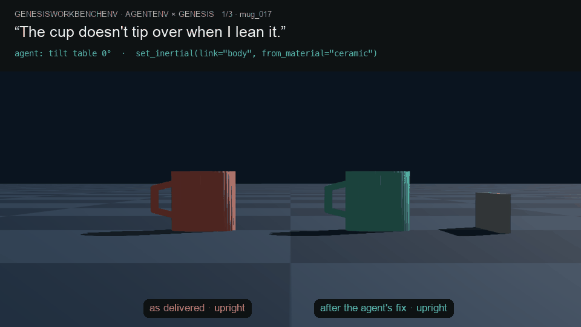
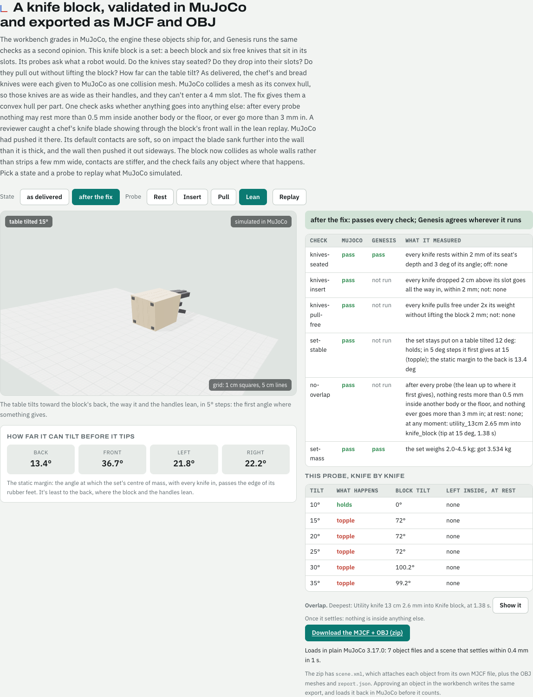
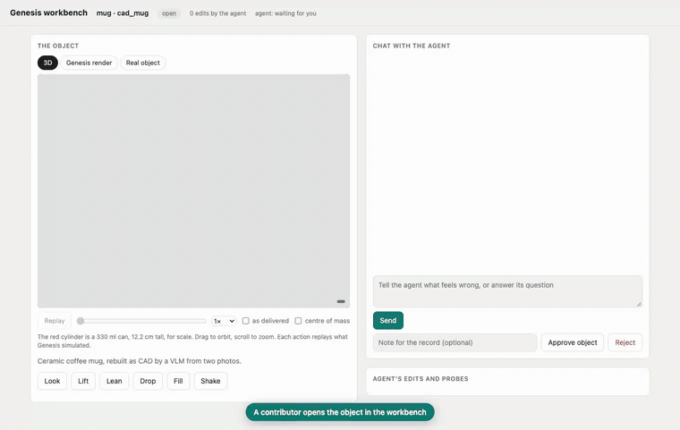
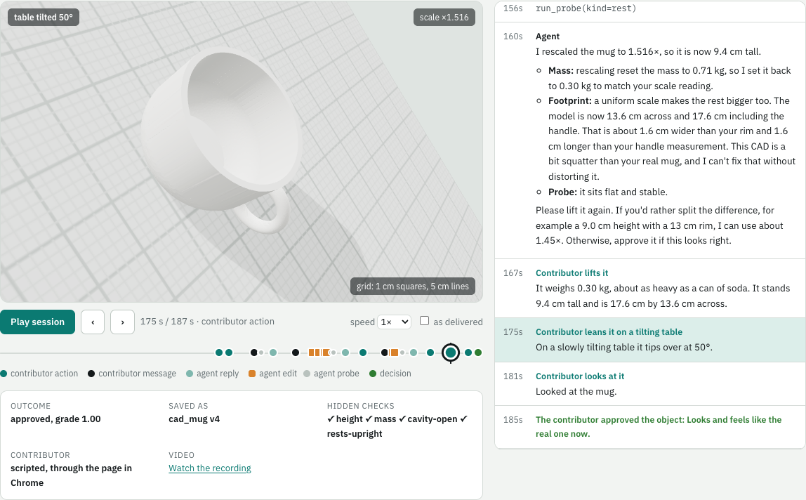

# GenesisWorkbenchEnv for AgentEnv



*Each object as delivered (red) beside the agent's fix (teal), simulated and rendered by Genesis from the MJCF recorded in the episodes: the mug on a tilt table, the oven door unlatched at 5°, the drawer pulled with 10 N.*

An [AgentEnv](https://github.com/scaleapi/agentenv-framework) environment where an agent fixes the physics of
sim-ready objects. Every probe and hidden check runs in [MuJoCo](https://mujoco.org), the engine the objects ship for,
and the [Genesis](https://github.com/Genesis-Embodied-AI/genesis-world) simulator runs the same checks as a second opinion.
An approved object is written as MJCF and OBJ files that load in plain MuJoCo.

Objects come out of a VLM-to-CAD pipeline as MJCF, and they're often physically wrong. A mug that rights itself like a
weighted toy, an oven door too light to swing open, a drawer welded shut. In this env a contributor's complaint is the
task. The agent inspects the object, renders it and runs probes, then edits mass properties, materials, collision and
joints through MCP tools. A hidden probe suite grades the result against how the real object behaves.

- Dataset of recorded episodes: [earakely-scale/GenesisWorkbenchEnv-AgentEnv](https://huggingface.co/datasets/earakely-scale/GenesisWorkbenchEnv-AgentEnv)
- Episode viewer: [Space](https://huggingface.co/spaces/earakely-scale/GenesisWorkbenchEnv-AgentEnv)

## Tasks

| Task | Object | Complaint | What is actually wrong | Hidden checks |
|---|---|---|---|---|
| `mug-tip` | `mug_017` | "The cup doesn't tip over when I lean it." | The inertial frame sits at the base (COM 0.3 cm), so it can lean 85° without falling | tips on a tilt table within 6° of a real mug (45.4°); ceramic mass band; rests upright |
| `oven-door` | `oven_004` | "Make the oven door heavier so it swings open." | 1.2 kg door against 4.0 N·m of hinge friction; gravity supplies at most 2.6 N·m | released at 5°, opens to ≥ 85° within 2 s; stops at its 90° limit; mass in a steel-and-glass door's band |
| `drawer-slide` | `cabinet_022` | "This drawer should slide." | The drawer has no joint | a 10 N pull opens it ≥ 0.30 m; it stops before leaving the cabinet; a slide joint along the depth axis |
| `wiring` | `mug_017` | none | No agent: loads and grades the object as delivered | expected to fail |

Eight more tasks use real assets and the defects [the asset audit](docs/asset-audit.md) found in them, and one uses a knife-block set:

| Task | Object (source) | Complaint | What is actually wrong | Hidden checks |
|---|---|---|---|---|
| `scan-mug-heavy` | `scan_mug` (Google Scanned Objects) | "This mug weighs a ton when I lift it, like it's full of sand." | No inertial in the file, so the loader fills it at water density: 1.25 kg | mass 0.30–0.45 kg; cavity open; rests upright; stable to 20° |
| `scan-bowl-heavy` | `scan_mixing_bowl` (GSO) | "Lifting this plastic mixing bowl feels like lifting a bag of cement." | Same, 10.5 kg for a plastic bowl | mass 0.25–0.55 kg; cavity open; rests upright |
| `cad-mug-small` | `cad_mug` (VLM-to-CAD) | "This mug is tiny, like an espresso cup next to my hand…" | The VLM built it at 0.7× scale; scaling it up then makes it too heavy | height 8.5–11.5 cm; mass 0.25–0.45 kg; cavity; upright |
| `cad-bowl-small` | `cad_serving_bowl` (VLM-to-CAD) | "This is supposed to be a big serving bowl for the table, but it's the size of a cereal bowl." | Built at 0.5× scale | width 28–36 cm; mass 1.2–3.0 kg; cavity; upright |
| `cad-coffeemaker-heavy` | `cad_coffee_maker` (VLM-to-CAD) | "The coffee maker is as heavy as a microwave…" | Solid plastic housing and a solid steel carafe: 10.7 kg | mass 2.2–3.6 kg; upright; stable to 20° |
| `cad-frother-ring` | `cad_milk_frother` (VLM-to-CAD) | "There's a blue ring floating next to the milk frother…" | The power cord is a separate ring 2 cm from the body | no floating parts; mass 0.4–1.2 kg; upright |
| `rcad-cabinet-sliders` | `rcad_cabinet` (ReplicaCAD) | "The sliding doors on this cabinet won't slide." | The doors' collision boxes collide with each other and the frame (self-collision) | every door reaches 90% of its travel, within limits |
| `rcad-cupboard-doors` | `rcad_cupboard` (ReplicaCAD) | "One of the lower doors on the kitchen cupboard won't open…" | Same, between neighbouring doors | every door reaches 90% of its travel, within limits |
| `knife-block-hull` | `knife_block` (procedural set) | "The two big knives won't go into the block. They sit on top of their slots and fall over." | The chef's and bread knives collide as one convex hull each, 21 mm wide, against 4.5 mm slots | every knife seats, drops in and pulls free; the set stays put to 12°; mass 2.0–4.5 kg |

## Tools the agent gets

| Tool | What it does |
|---|---|
| `inspect()` | Links with mass, centre of mass, inertia and material; joints; the materials table |
| `render()` | Schematic side view with the centre of mass and joints, beside the last probe's curve (PNG) |
| `set_inertial(link, mass?, com?, inertia?, from_material?)` | Set mass properties, or recompute them from the link's geometry at a material's density |
| `set_material(link, material)` | Real material: friction plus recomputed mass properties |
| `set_joint(name, type?, axis?, range?, damping?, frictionloss?)` | Create or edit a hinge or slide joint |
| `run_probe(kind, engine?)` | Build a scene from the current object and measure one behaviour, in MuJoCo by default or in Genesis for a second opinion; numbers plus a plot |
| `set_collision(body, mode)` | Sets: collide a body as one convex hull per part, or as one hull of the whole body |
| `diff()` | What changed against the object as delivered |
| `set_shell(part, thickness)` | Mesh objects: make a part a hollow shell, its mass from surface area × thickness × density |
| `set_scale(factor)` | Mesh objects: rescale uniformly; mass properties follow the geometry |
| `source_photo()` | VLM-to-CAD objects: the photos of the real object the CAD was built from, on a 1 cm grid |
| `remove_part(part, restore?)` | Mesh objects: drop a stray part, or put it back |
| `set_self_collision(enabled)` | Articulated objects: whether the object's links collide with each other |

| `last_interaction(count?)` | What the contributor did in the browser: their latest actions, what each showed them, the numbers, and the latest image |

The tilt-table probe rotates gravity per environment in one batched `scene.build(n_envs=12)`. That's a quasi-static
tilt test, and it avoids the impulse Genesis applies when an object's pose is set directly into a leaning contact.

## MuJoCo grades, Genesis gives a second opinion, and approved objects ship as MJCF and OBJ

Objects ship as MJCF and OBJ for MuJoCo, so they pass or fail in MuJoCo (`mj.py`). Every probe a contributor runs, every
probe the agent runs by default, and every hidden check runs there: the same floor, 2 ms step and thresholds as the
Genesis probes. Genesis then runs the same checks, and each graded episode lists `second_opinion` and where the engines
disagree. [`docs/parity.md`](docs/parity.md) compares them probe by probe. The articulated ReplicaCAD furniture is the
exception: it still grades in Genesis, until its URDF meshes (GLB) are converted for MuJoCo.

Approving an object writes it as it ships (`export.py`), into the sim asset's zip under `mujoco/`:

- `scene.xml`, which attaches each object from its own MJCF file at its place (`<model>` and `<attach>`);
- one MJCF per object, every body with an explicit `<inertial>` and friction per geom from its material;
- the OBJ meshes and textures, with collision as convex pieces in group 3 and visuals in group 2;
- `report.json`, with the checks, the probes, the second opinion and the load check.

Every file is loaded back and the scene stepped in MuJoCo before the export counts. It also loads in a clean
environment with only `mujoco` installed.

### A set: the knife block



A set is a group of free bodies that fit together: a slanted beech block on rubber feet, and six knives that sit in its
slots (`scripts/build_knife_block.py`). The block's collision is 29 convex pieces that leave the slots open, and each
knife collides as a convex hull per part (blade, bolster, handle). Its probes ask what a robot would:

- `rest`: does each knife stay seated?
- `seat`: dropped in from 2 cm above, does each knife go all the way into its slot?
- `extract`: pulled out along its slot, when does each knife come free, and does the block lift?
- `tip`: on a table tilted toward the block's back, where it leans, at what angle does it go?

Alongside these, `stability` reports its static tipping margin in each direction.

The `knife-block-hull` and `contributor-knife-block` tasks seed a defect common in generated assets. The chef's and
bread knives were each given to MuJoCo as one collision mesh, so they collide as one convex hull as wide as their
handles (21 mm), and they can't enter a 4.5 mm slot. The [Space](https://huggingface.co/spaces/earakely-scale/GenesisWorkbenchEnv-AgentEnv)
replays every probe in 3D, as delivered and fixed, and has the exported MJCF and OBJ to download.

## The contributor workbench



*A contributor session on `contributor-cad-mug`, recorded in Chrome with `scripts/record_session.py`, sped up while the agent
works. The red cylinder is a 330 ml can, for scale. Full videos are in the
[dataset](https://huggingface.co/datasets/earakely-scale/GenesisWorkbenchEnv-AgentEnv/tree/main/videos) and the
[Space](https://huggingface.co/spaces/earakely-scale/GenesisWorkbenchEnv-AgentEnv).*

In the tasks above the complaint is written into the task. In the `contributor-*` tasks a person (or a script standing
in for one) is in the loop:

1. The env serves a page at `/workbench`. The contributor can **look** at the object, **lift** it (its weight in
   everyday terms, and its size), **lean** it on a tilting table, **drop** it, **fill** it with marbles, **shake** it
   to find loose parts, or **open** and **pull** doors and drawers. Each action runs Genesis on the object as it is now.
   The page draws the object in 3D (three.js) from the meshes Genesis simulates: one GLB node per Genesis visual geom,
   on a real-scale grid beside the can, with orbit and zoom, a ghost of the object as delivered, and the centre of mass.
   Each action replays the poses Genesis recorded for every geom: the table tilting under the lean test, the drop,
   marbles falling in, loose parts lit, doors swinging. A **Real object** tab shows the photos the CAD was built from.
2. Each action is logged. The agent reads the log with `last_interaction`, and every message relayed to it lists what
   the contributor tried since its last reply.
3. The contributor chats with the agent on the same page. The `workbench_session` step is `prompt_agent` with the
   contributor as the agent's counterpart: the env serves an A2A peer at `/workbench/peer`, which answers each agent
   reply with the contributor's next message. The page also lists the agent's edits and probes as they happen.
4. **Approve** locks the object and ends the conversation. `save_sim_asset` saves the approved object as a new version
   of a file artifact (`@local/genesis-workbench/sim-assets/<object>`): a zip of the edited `asset.json`, its MJCF, the
   acceptance checks and probe results run at approval, the session (chat, actions, the agent's calls), and the 3D
   scene of the object approved and as delivered (`scene.glb`, `as_delivered.glb`). The artifact's metadata carries
   the checks' outcome. The hidden checks then grade the run as in the other tasks.

| Task | Object | Why a contributor helps |
|---|---|---|
| `contributor-cad-mug` | `cad_mug` (VLM-to-CAD, 0.7× scale) | No agent fixed it alone: the real size isn't in the asset |
| `contributor-cad-bowl` | `cad_serving_bowl` (VLM-to-CAD, 0.5× scale) | The same |
| `contributor-rcad-cupboard` | `rcad_cupboard` (ReplicaCAD) | The contributor can see which doors stick |
| `contributor-scan-mug` | `scan_mug` (Google Scanned Objects) | The contributor knows what the real mug weighs |
| `contributor-cad-coffeemaker` | `cad_coffee_maker` (VLM-to-CAD) | The same, for a hollow appliance the CAD made solid |
| `contributor-cad-frother` | `cad_milk_frother` (VLM-to-CAD) | Shake finds the loose cord ring, and the contributor knows the real one has none |
| `contributor-knife-block` | `knife_block` (procedural set) | Insert shows two knives that won't go in; the contributor knows every knife should |

`scripts/contributor.py` is a scripted contributor for these tasks, over the page's HTTP API, and
`scripts/record_session.py` plays the same personas through the page in Chrome and records a video. It reads only what the page shows, answers the
agent's questions with what someone holding the real object would know, checks each fix in the browser, and approves
or rejects. To be the contributor yourself, start the run, open the address from its `WORKBENCH` log line, and play:

```bash
agent-env run genesis-workbench --task contributor-cad-mug   # logs: WORKBENCH contributor page for …: http://localhost:<port>/workbench
python scripts/contributor.py --persona cad_mug --log run.log # or let the script play the contributor
```

The Space replays each session interactively. The 3D view follows one timeline of the contributor's actions, the chat and
the agent's edits, showing the object as it was at each moment and playing back each action's Genesis trace
(`scripts/build_space_replay.py` builds it from the sessions):



The env uses the `server` env provider (`env.toml`), with no gateway in front, so the page is at the env's own
address. The page has no authentication; on a remote host, reach it through an SSH tunnel.

With a scripted contributor and Claude Code on `claude-sonnet-5-5`, every contributor session so far scored 1.00 and was
approved, in 1 to 3 minutes each (`sessions.jsonl` in the dataset has each one). Without a contributor, the mug and bowl had scored 0.50 (Sonnet) and 0.75 (Opus). In both, the agent
asked the contributor for the real size instead of guessing. On the mug it also said why one scale factor can't match
both the real height and rim. The sessions are in the dataset (`sessions.jsonl`).

The page runs Genesis on the server for every action. To let the browser simulate instead, [docs/parity.md](docs/parity.md)
compares Genesis with MuJoCo on the same MJCF:

- The tilt angle agrees within 5° on all 12 object variants.
- Drop, rest and cavity agree everywhere.
- On 3 variants near the friction limit, one engine has the object tip over where the other has it slide.

So MuJoCo in the browser with Genesis grading on the server works for rigid objects.

## Run it

You need Docker, and a model endpoint that serves Anthropic's Messages API (a LiteLLM gateway, say):

```bash
uv tool install agentenv-framework
agent-env plugin add 'agentenv-genesis @ git+https://github.com/earakely-scale/agentenv-genesis-plugin'
export LITELLM_BASE_URL=<gateway URL> LITELLM_API_KEY=<key>
agent-env run genesis-workbench --task contributor-cad-mug --model anthropic/claude-sonnet-5-5
```

Open the `…/workbench` address the run prints and play the contributor. Tasks without `contributor-` in their name
need no one on the page, for example `--task scan-mug-heavy`.

The env image installs `genesis-world==1.4.5` with CPU PyTorch and runs Genesis on its CPU backend, so any Docker
host works. The first probe in a container compiles Genesis kernels (about 25 s); later probes build in well under a
second. Set `GENESIS_EPISODES_DIR` to keep each graded episode as JSON: every tool call, the renders, the MJCF before
and after, and the probe curves. `scripts/publish_hub.py` turns those into the dataset and the Space.

## Layout

- `src/agentenv_genesis/bundles/genesis-workbench/`: the bundle
  - `envs/genesis-workbench/`: the env image (`server.py` is the MCP server; `workbench.py` and `assets.py` have the objects, MJCF, probes and renders; `session.py` and `workbench.html` are the contributor page)
  - `tasks/`: one JSON per task
  - `artifacts/workbench-probes/verify.py`: the verifier, which reads the hidden probe suite through `data/get`
- `src/agentenv_genesis/steps.py`: the `workbench_session` and `save_sim_asset` steps
- `scripts/contributor.py`: the scripted contributor
- `hub/`: the Hugging Face Space and dataset card
- `scripts/publish_hub.py`: publish episodes to the Hub

## Limitations

This is a prototype. The probe tolerances and material bands are example values, and the three original objects are built
from primitives. MuJoCo grades the mesh objects and sets; the articulated ReplicaCAD furniture still grades in Genesis.
Where the two engines disagree (tipping against sliding near the friction limit, say; see `docs/parity.md`), the
episode says so, and MuJoCo's result counts.

## License

Apache-2.0. Genesis is Apache-2.0. The scanned and ReplicaCAD assets are CC BY 4.0; see NOTICE.
