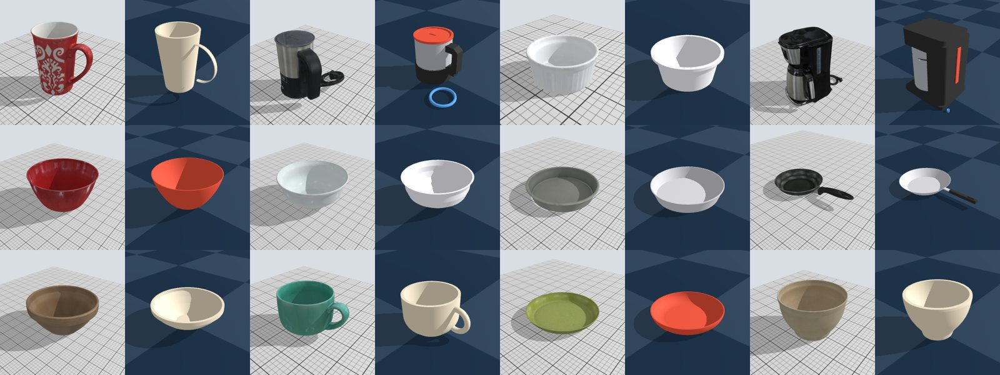

# What breaks when real kitchen objects go into Genesis

An audit of 29 assets from three sources, run through the plausibility probes in `scripts/audit_assets.py` on
Genesis 1.4.5 (CPU backend). The goal is to find the physics defects a sim-asset pipeline actually produces, so the
workbench's probes and tasks target real failures rather than invented ones.



*Scanned objects (light) beside the CAD that Claude Sonnet 5.5 wrote from two renders with a 1 cm grid (dark). The
scans are Google Scanned Objects (CC BY 4.0).*

## Sources

| Source | What | License | Count |
|---|---|---|---|
| [Google Scanned Objects](https://research.google/blog/scanned-objects-by-google-research-a-dataset-of-3d-scanned-common-household-items/) via [mujoco_scanned_objects](https://github.com/kevinzakka/mujoco_scanned_objects) | Rigid kitchen objects: textured scan + 32 convex collision pieces, as MJCF | CC BY 4.0 (scans) | 12 |
| [ReplicaCAD](https://huggingface.co/datasets/ai-habitat/ReplicaCAD_dataset) | Articulated furniture as URDF: kitchen cupboard, chest of drawers, kitchen counter, fridge, cabinet | CC BY 4.0 | 5 (25 joints) |
| VLM-to-CAD (`scripts/vlm_to_cad/`) | The same 12 scanned objects, rebuilt by Claude Sonnet 5.5 as CadQuery from two renders and a category label, one material per part; code run sandboxed (`--network none`) | generated | 12 |

The VLM-to-CAD step stands in for step 2 of the pipeline (VLM-to-CAD with common materials). It cost $0.17 for all 12
objects, and every object produced valid CAD on the first try.

## Probes

Every rigid object gets: mass against an approximate real weight band (our estimate from typical retail specs),
drop from twice its height (settle time and penetration), a tilt-table sweep from 10° to 70° (first angle it topples
or slides), and, for containers, five 8 mm spheres dropped into the opening (does the collision geometry keep the
cavity open?). Articulated assets get each joint driven to 90% of its limit with a PD controller, with Genesis's
self-collision on and off.

## Findings

### Scanned objects: geometry is good, physics is absent

| Object | Genesis mass as loaded | Real band | Off by |
|---|---|---|---|
| Mug, 16 oz | 1.25 kg | 0.30–0.45 kg | ×3–4 |
| Mug, classic | 1.93 kg | 0.25–0.40 kg | ×5–8 |
| Ramekin | 0.39 kg | 0.08–0.16 kg | ×2–5 |
| Mixing bowl, 7 qt plastic | 10.5 kg | 0.25–0.55 kg | ×19–42 |
| Frying pan, 8" aluminium | 1.81 kg | 0.4–0.8 kg | ×2–5 |
| Cake pan, 9" | 3.14 kg | 0.20–0.45 kg | ×7–16 |
| Milk frother | 2.33 kg | 0.4–1.2 kg | ×2–6 |
| Coffee maker | 25.2 kg | 2.2–3.6 kg | ×7–11 |
| Deep bowl | 9.37 kg | 0.8–2.5 kg | ×4–12 |
| Footed bowl | 2.61 kg | 0.3–0.8 kg | ×3–9 |
| Plate | 1.36 kg | 0.10–0.35 kg | ×4–14 |

- **Every scanned object is far too heavy, by 2× to 42×.** The MJCF declares no inertial or density, so the simulator
  fills the 32 convex collision pieces at water density (1,000 kg/m³). The pieces are solid, so thin walls become thick.
- **Mesh volume can't fix it: 0 of 12 scan meshes are watertight.** Volume × the real material's density is undefined,
  and the convex-hull fallback is no better (the 32 cm ceramic bowl comes out at 18 kg, the coffee maker at 17 kg).
- **The bodies are static as delivered.** They have no joint, so MuJoCo-style loaders weld them to the world. The audit
  adds a free joint before any dynamic probe.
- **Collision is good.** The convex decomposition keeps every container's cavity open (5 of 5 spheres land inside in
  all 9 containers). Drop penetration is 1–8 mm, worst on thin-walled pans and bowls.
- **One scan is mislabelled.** GSO's "Calphalon … 12 Cast Iron Fry Pan" is a white footed serving bowl. Any pipeline
  that trusts names for material or size priors inherits this.

### VLM-to-CAD: mass is right, scale and assembly aren't

- **Mass lands in the real band for 9 of 11 objects** (two of them within 10% of an edge; one object has no reliable band). Hollow walls, 1.5–8 mm thick, plus a
  material per part do what the scans' defaults can't. The exceptions:
  - the coffee maker is 10.7 kg against 2.2–3.6 kg, because the VLM modelled the housing as mostly solid ABS with a 2 cm
    base plate;
  - the second mug is 0.20 kg against 0.25–0.40 kg, because it came out at 0.7× scale.
- **Scale is the biggest geometric error, even with a 1 cm grid in view.** Half the objects are within about 10%. The
  rest are off by 0.5× to 1.3× on at least one axis: a bowl at 0.5× in every axis, a mug at 0.7×, a frying pan 1.3× too
  long and 0.76× too tall.
- **The parts don't form a clean assembly.** The coffee maker's housing overlaps its carafe and band by 61 cm³ each, the
  frother's base overlaps its jug, and a pan's handle overlaps the pan. Power cords are separate rings floating 14–24 mm
  from the body. In a simulator, overlapping parts of one body are harmless, but overlapping or floating parts of
  separate bodies are not.
- **Tilt behaviour differs from the scan by 10–20° on 4 of 12 objects** (the frother topples at 40° vs 20° for the
  scan, the classic mug at 45° vs 30°, the coffee maker at 45° vs 30°, the mixing bowl at 30° vs 45°). On the frother
  and coffee maker, per-part materials move the centre of mass where the scans' uniform density can't; on the mug and
  bowl, the CAD's scale and shape errors do. Neither side is ground truth, which is what the contributor in the loop
  is for.

### ReplicaCAD: format defects and simulator assumptions

- **No URDF loads in Genesis as delivered.** 27 mesh scales are written with commas (`scale="1, 1, 1"`), and one
  collision box in the kitchen counter has a stray comma in its size (`0.617 0.145, 0.894`). The audit sanitises both.
- **Every link has placeholder inertia.** All 30 links declare an identity inertia tensor, with a comment that the
  loader is expected to compute the real one. Genesis uses it as given.
- **Masses and damping are placeholders.** Every cupboard door weighs 8 kg and every hinge has damping 0.01.
- **The assets assume self-collision between links is filtered.** With Genesis's default (self-collision on), the
  cabinet's two sliding doors move 5% of their range and one cupboard door doesn't open at all (another reaches 75%).
  With self-collision off, all of them reach 100%. Habitat, which ReplicaCAD was built for, filters these pairs.
- **The up axis differs between files in the same dataset.** ReplicaCAD is authored Y-up, so in a Z-up simulator the
  cabinet lies on its back, which also changes how gravity acts on its hinges. The kitchen cupboard, by contrast,
  turns itself upright through a root joint (`rpy="1.565 0 0"`). An importer has to check each file rather than rotate
  the whole set.
- **The kitchen counter's three middle drawers don't move at all**, even with self-collision off; their limits are a
  normal 0–0.5 m. The cause isn't isolated yet.

## What this means for the pipeline

1. **Never trust mass from geometry alone.** Neither scan meshes nor convex pieces give real mass. Material per part
   plus modelled wall thickness (what the VLM-to-CAD step did) works; density defaults don't. The workbench should
   check mass against a per-class band before a contributor ever sees the object.
2. **Scale needs its own check.** Even with a grid, a VLM is off by up to 2×. Compare the bounding box against a
   class prior (mugs 8–13 cm tall), and against the source frame's depth or a known object, before anything else.
3. **Assemble before simulating.** Reject overlapping parts that will become separate bodies, attach or drop floating
   parts, and decimate heavy meshes (up to 157k faces here) before convex decomposition.
4. **Sanitise and normalise imported formats.** That means comma-separated values, missing or placeholder inertia,
   missing joints (bodies welded to the world), and self-collision filtering for adjacent links.
5. **The bugs the workbench tasks should cover**, in rough order of frequency here: wrong mass from default density,
   wrong scale, solid housings on hollow appliances, placeholder inertia and masses on articulated parts, self-collision
   jams, and overlapping or floating parts.

## Reproduce

```bash
python scripts/vlm_to_cad/run.py ...      # see the script's docstring; needs ANTHROPIC_BASE_URL, ANTHROPIC_API_KEY and a Docker host
python scripts/audit_assets.py --gso <mujoco_scanned_objects>/models --replicacad <ReplicaCAD_dataset> --vlmcad <vlmcad> --out results/audit
```

Raw results: `docs/audit/gso.json`, `docs/audit/replicacad.json`, `docs/audit/vlmcad.json`.
